# Modelo Entidade-Relacionamento — v0.1

> Modelo inicial derivado dos requisitos funcionais, regras de negócio e decisões de projeto da ferramenta.
>
> Este modelo representa o domínio da aplicação e ainda poderá ser refinado durante a definição do diagrama de classes e da implementação.

```mermaid
erDiagram

    USER {
        id id PK
        string name
        string email
        string password_hash
    }

    REFERENCE_ARCHITECTURE {
        id id PK
        id owner_user_id FK
        string name
        string visibility
    }

    RA_VERSION {
        id id PK
        id reference_architecture_id FK
        string version
        text description_markdown
        datetime created_at
    }

    ARCHITECTURAL_ELEMENT_TYPE {
        id id PK
        string name
        id created_by_user_id FK
    }

    RA_ELEMENT {
        id id PK
        id ra_version_id FK
        id element_type_id FK
        string name
        text description_markdown
    }

    CHECKLIST {
        id id PK
        id owner_user_id FK
        id derived_from_checklist_version_id FK
        string name
        text origin
        string visibility
    }

    CHECKLIST_VERSION {
        id id PK
        id checklist_id FK
        string version
        datetime created_at
    }

    CHECKLIST_SECTION {
        id id PK
        id checklist_version_id FK
        string name
        int order_index
    }

    QUESTION {
        id id PK
        id checklist_version_id FK
        id section_id FK
        text statement
        string response_type
        string comment_mode
        int order_index
    }

    RESPONSE_OPTION {
        id id PK
        id question_id FK
        string label
        int order_index
    }

    STAKEHOLDER_ROLE {
        id id PK
        id checklist_version_id FK
        string name
        string description
    }

    QUESTION_STAKEHOLDER {
        id question_id FK
        id stakeholder_role_id FK
    }

    CHECKLIST_EVALUATION {
        id id PK
        id ra_version_id FK
        id checklist_version_id FK
        id created_by_user_id FK
        string status
        datetime created_at
    }

    EVALUATION_PARTICIPANT {
        id id PK
        id checklist_evaluation_id FK
        id user_id FK
    }

    PARTICIPANT_ROLE {
        id evaluation_participant_id FK
        id stakeholder_role_id FK
    }

    ANSWER {
        id id PK
        id evaluation_participant_id FK
        id question_id FK
        id response_option_id FK
        text text_value
        text comment
    }

    CONCRETE_ARCHITECTURE {
        id id PK
        id owner_user_id FK
        string name
    }

    CONCRETE_ARCHITECTURE_VERSION {
        id id PK
        id concrete_architecture_id FK
        id base_ra_version_id FK
        string version
        text description_markdown
        datetime created_at
    }

    CONCRETE_ELEMENT {
        id id PK
        id concrete_architecture_version_id FK
        id element_type_id FK
        string name
        text description_markdown
    }

    ELEMENT_MAPPING {
        id id PK
        id concrete_element_id FK
        id ra_element_id FK
    }

    CONFORMANCE_CRITERION {
        id id PK
        id ra_version_id FK
        string name
        text description
    }

    CRITERION_RA_ELEMENT {
        id conformance_criterion_id FK
        id ra_element_id FK
    }

    CONFORMANCE_EVALUATION {
        id id PK
        id concrete_architecture_version_id FK
        id created_by_user_id FK
        string status
        datetime created_at
    }

    CONFORMANCE_RESULT {
        id id PK
        id conformance_evaluation_id FK
        id conformance_criterion_id FK
        string status
        text notes
    }

    CONFORMANCE_EVIDENCE {
        id id PK
        id conformance_result_id FK
        text description
        string external_url
    }

    VIOLATION {
        id id PK
        id conformance_result_id FK
        text description
    }

    VIOLATION_RA_ELEMENT {
        id violation_id FK
        id ra_element_id FK
    }

    VIOLATION_CONCRETE_ELEMENT {
        id violation_id FK
        id concrete_element_id FK
    }


    USER ||--o{ REFERENCE_ARCHITECTURE : owns
    USER ||--o{ CHECKLIST : owns
    USER ||--o{ CONCRETE_ARCHITECTURE : owns

    USER o|--o{ ARCHITECTURAL_ELEMENT_TYPE : creates

    REFERENCE_ARCHITECTURE ||--|{ RA_VERSION : has
    RA_VERSION ||--o{ RA_ELEMENT : contains
    ARCHITECTURAL_ELEMENT_TYPE ||--o{ RA_ELEMENT : classifies
    ARCHITECTURAL_ELEMENT_TYPE ||--o{ CONCRETE_ELEMENT : classifies

    CHECKLIST ||--|{ CHECKLIST_VERSION : has
    CHECKLIST_VERSION o|--o{ CHECKLIST : originates
    CHECKLIST_VERSION ||--o{ CHECKLIST_SECTION : contains
    CHECKLIST_VERSION ||--o{ QUESTION : contains
    CHECKLIST_SECTION o|--o{ QUESTION : groups

    QUESTION ||--o{ RESPONSE_OPTION : provides
    CHECKLIST_VERSION ||--o{ STAKEHOLDER_ROLE : defines

    QUESTION ||--o{ QUESTION_STAKEHOLDER : targets
    STAKEHOLDER_ROLE ||--o{ QUESTION_STAKEHOLDER : assigned_to

    RA_VERSION ||--o{ CHECKLIST_EVALUATION : evaluated_by
    CHECKLIST_VERSION ||--o{ CHECKLIST_EVALUATION : used_by
    USER ||--o{ CHECKLIST_EVALUATION : creates

    CHECKLIST_EVALUATION ||--o{ EVALUATION_PARTICIPANT : has
    USER ||--o{ EVALUATION_PARTICIPANT : participates

    EVALUATION_PARTICIPANT ||--o{ PARTICIPANT_ROLE : assumes
    STAKEHOLDER_ROLE ||--o{ PARTICIPANT_ROLE : assigned

    EVALUATION_PARTICIPANT ||--o{ ANSWER : submits
    QUESTION ||--o{ ANSWER : receives
    RESPONSE_OPTION o|--o{ ANSWER : selected_in

    CONCRETE_ARCHITECTURE ||--|{ CONCRETE_ARCHITECTURE_VERSION : has
    RA_VERSION ||--o{ CONCRETE_ARCHITECTURE_VERSION : basis_for
    CONCRETE_ARCHITECTURE_VERSION ||--o{ CONCRETE_ELEMENT : contains

    CONCRETE_ELEMENT ||--o{ ELEMENT_MAPPING : maps
    RA_ELEMENT ||--o{ ELEMENT_MAPPING : mapped_to

    RA_VERSION ||--o{ CONFORMANCE_CRITERION : defines

    CONFORMANCE_CRITERION ||--o{ CRITERION_RA_ELEMENT : applies_to
    RA_ELEMENT ||--o{ CRITERION_RA_ELEMENT : referenced_by

    CONCRETE_ARCHITECTURE_VERSION ||--o{ CONFORMANCE_EVALUATION : evaluated_by
    USER ||--o{ CONFORMANCE_EVALUATION : creates

    CONFORMANCE_EVALUATION ||--o{ CONFORMANCE_RESULT : contains
    CONFORMANCE_CRITERION ||--o{ CONFORMANCE_RESULT : evaluated_as

    CONFORMANCE_RESULT ||--o{ CONFORMANCE_EVIDENCE : supported_by
    CONFORMANCE_RESULT ||--o{ VIOLATION : may_generate

    VIOLATION ||--o{ VIOLATION_RA_ELEMENT : involves
    RA_ELEMENT ||--o{ VIOLATION_RA_ELEMENT : referenced_by

    VIOLATION ||--o{ VIOLATION_CONCRETE_ELEMENT : involves
    CONCRETE_ELEMENT ||--o{ VIOLATION_CONCRETE_ELEMENT : referenced_by
```

## Observações de modelagem

### Versionamento

`RA_VERSION`, `CHECKLIST_VERSION` e `CONCRETE_ARCHITECTURE_VERSION` existem separadamente de seus respectivos artefatos para preservar o histórico das avaliações.

Uma versão da arquitetura concreta referencia diretamente a versão da Arquitetura de Referência utilizada como sua base.

### Elementos arquiteturais

Os elementos da RA pertencem a uma versão específica e podem possuir tipos predefinidos ou customizados.

Os tipos não representam uma lista universal de elementos que todas as Arquiteturas de Referência devem possuir.

### Questões e seções

Toda questão pertence diretamente a uma versão de checklist.

A associação com `CHECKLIST_SECTION` é opcional, permitindo checklists sem organização em seções.

### Stakeholders

Os stakeholders/papéis são definidos no contexto de uma versão de checklist.

`QUESTION_STAKEHOLDER` representa a associação muitos-para-muitos entre questões e stakeholders.

A ausência de registros em `QUESTION_STAKEHOLDER` para uma questão indica que ela deve ser apresentada a todos os avaliadores.

### Respostas

`ANSWER` pode armazenar uma opção selecionada por meio de `response_option_id` ou uma resposta textual por meio de `text_value`, de acordo com o tipo configurado para a questão.

O comentário é armazenado separadamente do valor principal da resposta.

### Derivação de checklist

`derived_from_checklist_version_id` é opcional.

Quando preenchido, identifica a versão de checklist que originou uma nova checklist derivada, preservando a rastreabilidade sem permitir alteração do artefato original.

### Mapeamento entre arquiteturas

`ELEMENT_MAPPING` representa a relação muitos-para-muitos entre elementos da arquitetura concreta e elementos da RA.

Como os dois elementos já pertencem às respectivas versões, o mapeamento permanece vinculado implicitamente à combinação de versões correspondente.

### Critérios de conformidade

Todo critério pertence a uma versão da RA.

`CRITERION_RA_ELEMENT` é opcional. A ausência de associações indica que o critério se aplica à versão da RA como um todo.

### Avaliação de conformidade

A avaliação de conformidade referencia uma versão da arquitetura concreta.

A versão da RA avaliada pode ser determinada por meio da `base_ra_version_id` da versão concreta, evitando armazenar uma referência redundante e potencialmente inconsistente.

### Resultados consolidados

Não foram criadas entidades específicas para resultados consolidados.

Os resultados das avaliações por checklist e de conformidade são derivados das respostas, critérios, evidências e violações armazenadas e apresentados pela aplicação.

### Tipos de elementos arquiteturais

`ARCHITECTURAL_ELEMENT_TYPE.created_by_user_id` é opcional.

Quando não possuir um usuário criador, o tipo é considerado predefinido pela ferramenta. Quando possuir, representa um tipo customizado criado por um usuário.

### Identidade e conteúdo versionado

`REFERENCE_ARCHITECTURE` e `CONCRETE_ARCHITECTURE` representam a identidade dos artefatos.

O conteúdo que pode evoluir ao longo do tempo é mantido respectivamente em `RA_VERSION` e `CONCRETE_ARCHITECTURE_VERSION`, evitando que alterações posteriores modifiquem a representação considerada por avaliações anteriores.

### Valores das respostas

O valor principal armazenado em `ANSWER` depende do tipo configurado em `QUESTION.response_type`.

Para questões de seleção, `response_option_id` deve identificar a opção escolhida e `text_value` não é utilizado.

Para questões textuais, `text_value` deve armazenar a resposta e `response_option_id` não é utilizado.

O campo `comment` é independente do valor principal e respeita a configuração definida em `QUESTION.comment_mode`.